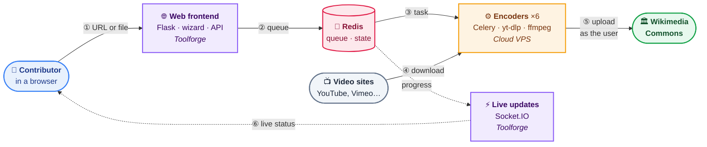

# video2commons [](https://github.com/toolforge/video2commons/actions/workflows/ci.yml) [](https://codeclimate.com/github/toolforge/video2commons)

**video2commons** imports video and audio into [Wikimedia Commons](https://commons.wikimedia.org).
Give it a link (YouTube, Vimeo, Flickr, NASA, any of the
[sites supported by yt-dlp](https://github.com/yt-dlp/yt-dlp/blob/master/supportedsites.md)…)
or upload a file from your computer: it downloads the media, converts it to a
free format (WebM/AV1, VP9, Ogg…) and uploads it to Commons under your own
account, with a pre-filled description, license and categories.

It is open to every [confirmed](https://commons.wikimedia.org/wiki/Commons:Confirmed_users)
Commons contributor and logs in through OAuth: video2commons never sees your
password.

👉 **Use it:** <https://video2commons.toolforge.org>

## How it works



1. In a step-by-step wizard, the user gives a URL (or uploads a file) and
   reviews the file name, description, license and output format suggested
   from the source's metadata.
2. The web frontend queues a **task** in Redis.
3. One of the **encoders** (Celery workers on Wikimedia Cloud VPS) picks it up…
4. …downloads the media with [yt-dlp](https://github.com/yt-dlp/yt-dlp), and
   converts it with ffmpeg when it isn't already in a free format…
5. …then uploads it to Commons with [Pywikibot](https://www.mediawiki.org/wiki/Manual:Pywikibot),
   on behalf of the user, along with any subtitles.
6. Meanwhile, the browser follows progress live through Socket.IO.

## Components

| Component | Code | Runs on | Tech |
|---|---|---|---|
| 🌐 Web frontend & API | [`video2commons/frontend`](video2commons/frontend) | Toolforge (`video2commons`) | Python, Flask, uWSGI, jQuery, Nunjucks |
| ⚡ Live updates | [`video2commons-socketio`](video2commons-socketio) | Toolforge (`video2commons-socketio`) | Node.js, Socket.IO |
| ⚙️ Encoders | [`video2commons/backend`](video2commons/backend) | Cloud VPS, project `video` (`encoding01`…`06`) | Python, Celery, yt-dlp, ffmpeg, Pywikibot |
| 🧠 Queue & shared state | — | Cloud VPS (`video-redis-bookworm`) | Redis |
| 🧩 Code shared by both sides | [`video2commons/shared`](video2commons/shared) | — | Python |
| 🛠️ Encoder provisioning | [`puppet`](puppet) | Cloud VPS | Puppet (masterless) |

## Repository layout

```
video2commons/
├── frontend/           Flask app: OAuth login, wizard API, uploads, i18n
│   ├── static/         Browser code (video2commons.js, ChunkedUploader.js) and Nunjucks templates
│   ├── templates/      Jinja2 page templates
│   └── i18n/           Translations, synced from translatewiki.net
├── backend/            Celery worker: download → encode → upload pipeline
│   ├── download/       yt-dlp wrapper
│   ├── encode/         ffmpeg transcoding (adapted from MediaWiki's TimedMediaHandler)
│   ├── upload/         Commons upload with retries
│   ├── subtitles/      Subtitle (TimedText) upload
│   └── categories/     Categories inferred from the media
├── shared/             Task status, stats, rate limiting, error messages
└── config.py           Reads config.json
video2commons-socketio/ Socket.IO server pushing task updates to browsers
puppet/                 Manifest that sets up an encoder instance
utils/                  Deployment, health check, maintenance and cookie scripts
www/                    Toolforge webservice entry points (Python and Node.js)
tests/                  JavaScript tests (Vitest)
```

## Documentation

- 🏗️ **[Architecture](docs/architecture.md)**: the components in detail, the
  life of a task, the encoding pipeline, queues, Redis, real-time updates and
  how the encoders are kept alive.
- 🚀 **[CI/CD](docs/ci-cd.md)**: what runs on each pull request, how each part
  is deployed, scheduled maintenance, and a deployment runbook.
- 🛠️ **[Puppet](puppet/README.md)**: encoder provisioning.
- 🍪 **[YouTube cookies](utils/cookies/README.md)**: refreshing the cookies used
  by the encoders.

## Development

You need Node.js (LTS) and [uv](https://docs.astral.sh/uv/) with Python 3.13.

```bash
npm ci              # install the JavaScript tooling
npx gulp build      # bundle the JS and minify the templates (*.min.js, *.min.html)
npm test            # run the JavaScript tests
npm run lint        # lint and check formatting of the JavaScript (Biome)
uv run ruff check . # lint the Python code
uv run ruff format --check .
```

The frontend and the workers read their settings (OAuth consumer, Redis…) from
a `config.json` at the root of the repository: see
[`config.json.example`](config.json.example). Running the whole stack needs a
Redis server, an OAuth consumer on Commons and ffmpeg.

Every pull request is checked by the same commands in GitHub Actions: see
[CI/CD](docs/ci-cd.md).

## Contributing

- 🐛 Bugs and ideas: [GitHub issues](https://github.com/toolforge/video2commons/issues)
- 🌍 Translations: [translatewiki.net](https://translatewiki.net/wiki/Translating:Video2commons)
  (do not edit `video2commons/frontend/i18n/*.json` by hand, except `en.json`
  and `qqq.json`)

## See also

- <https://commons.wikimedia.org/wiki/Commons:Video2commons>: user documentation
- <https://wikitech.wikimedia.org/wiki/Nova_Resource:Video/Help/video2commons>: Cloud VPS project

## License

[GPL-3.0-or-later](LICENSE)
