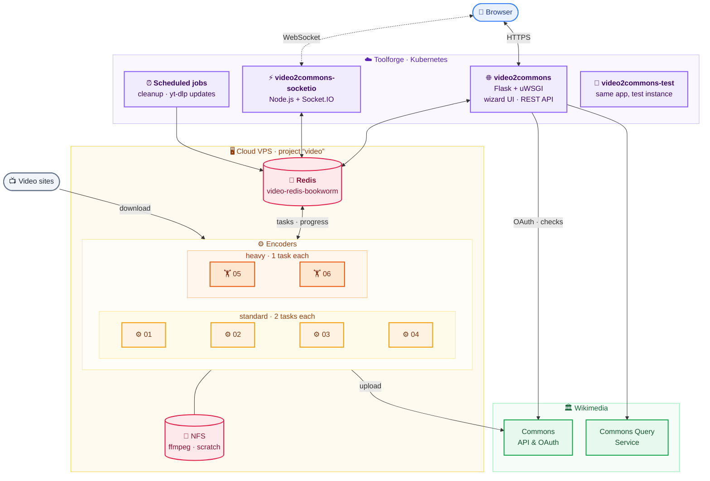
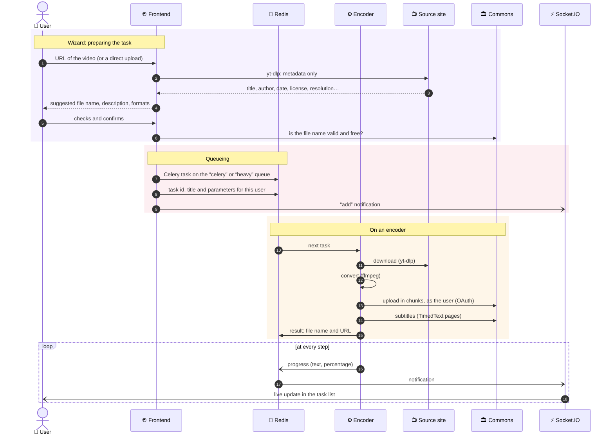
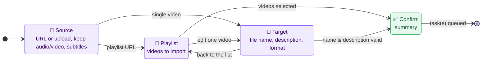
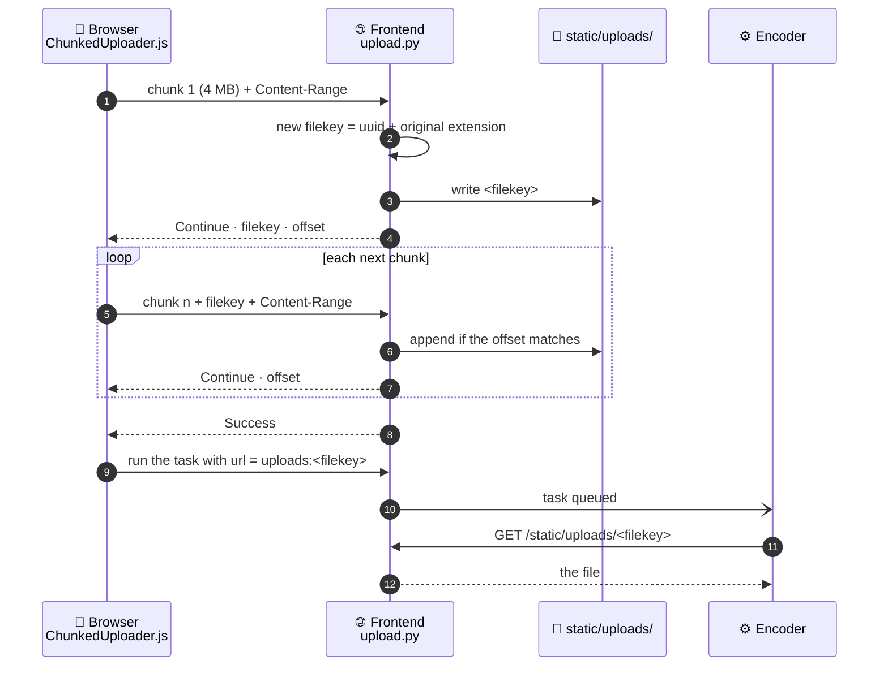
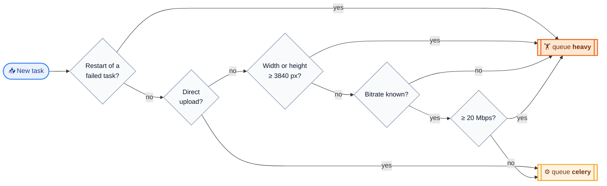
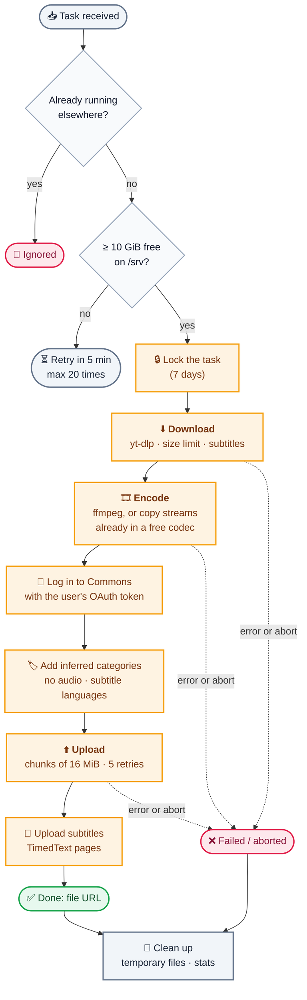
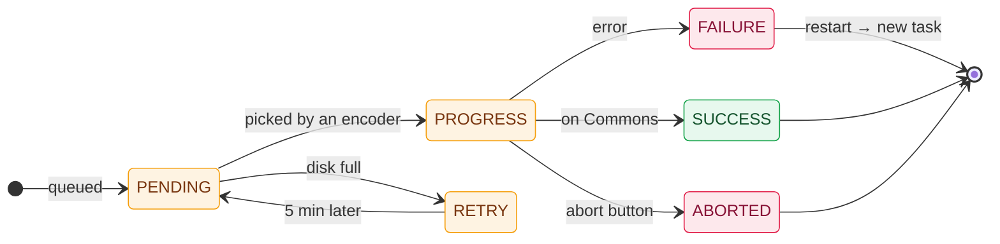
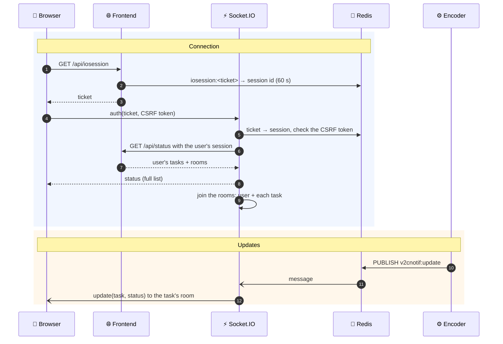
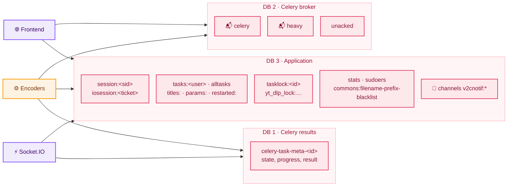
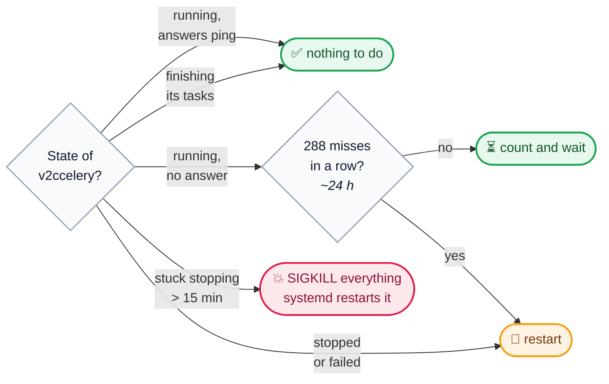

# Architecture

This document explains how video2commons is put together: where each part
runs, how a task travels from the browser to Commons, and what keeps the
system running. For builds and deployments, see [CI/CD](ci-cd.md).

- [The big picture](#the-big-picture)
- [Life of a task](#life-of-a-task)
- [The web frontend](#the-web-frontend)
- [Direct file uploads](#direct-file-uploads)
- [Queues and routing](#queues-and-routing)
- [The encoding pipeline](#the-encoding-pipeline)
- [Task states](#task-states)
- [Real-time updates](#real-time-updates)
- [Redis: the shared memory](#redis-the-shared-memory)
- [Login and permissions](#login-and-permissions)
- [Rate limiting and YouTube](#rate-limiting-and-youtube)
- [Keeping the encoders healthy](#keeping-the-encoders-healthy)
- [Configuration](#configuration)

## The big picture

video2commons is split in two halves that only talk to each other through
**Redis**:

- the **Toolforge** half faces users: a Flask web app and a Socket.IO server;
- the **Cloud VPS** half does the heavy lifting: six Celery workers, the
  *encoders*, which download, convert and upload media.

| Part | Where | What it does |
|---|---|---|
| **Web frontend** | Toolforge tool `video2commons` ([`frontend/`](../video2commons/frontend)) | Serves the UI, logs users in with OAuth, extracts metadata from URLs, validates file names and descriptions, receives direct uploads, queues tasks. |
| **Test frontend** | Toolforge tool `video2commons-test` | The same app, deployed automatically from `master` to try changes. |
| **Socket.IO server** | Toolforge tool `video2commons-socketio` ([`video2commons-socketio/`](../video2commons-socketio)) | Pushes task progress to browsers in real time. |
| **Encoders** | Cloud VPS `encoding01`…`encoding06` ([`backend/`](../video2commons/backend)) | Celery workers running the download → encode → upload pipeline. |
| **Redis** | Cloud VPS `video-redis-bookworm` | Task queue, task results, sessions, task lists, locks, statistics and notifications. |
| **Shared code** | [`shared/`](../video2commons/shared) | Used by both halves: task status, statistics, rate limiting, error messages. |

## Life of a task

From the first click to the file on Commons:

The frontend never encodes anything and the encoders never talk to the
browser: everything goes through Redis. A task can be **aborted** or
**restarted** from the task list (see [Task states](#task-states)).

## The web frontend

[`frontend/app.py`](../video2commons/frontend/app.py) is a Flask app run by
uWSGI on Toolforge. It serves:

- the page itself, built from Jinja2 templates, and the browser code
  [`static/video2commons.js`](../video2commons/frontend/static/video2commons.js),
  which renders the wizard with precompiled Nunjucks templates
  (`static/templates/`);
- the **OAuth** login (`/oauthinit`, `/oauthcallback`, `/logout`);
- a JSON **API** under `/api` ([`frontend/api.py`](../video2commons/frontend/api.py));
- translations under `/i18n`, synced from translatewiki.net.

The wizard is a small state machine on the browser side:

Main API endpoints (all `POST` calls need the CSRF token given by `/api/csrf`):

| Endpoint | Role |
|---|---|
| `GET /api/status` | Tasks visible to the user (all tasks for maintainers), with worker statistics. |
| `POST /api/extracturl` | Runs yt-dlp **without downloading** to get the metadata and build a pre-filled description. Also detects playlists. |
| `POST /api/listformats` | Output formats available for the chosen audio/video combination. |
| `POST /api/validateurl` | Checks whether the video is already on Commons, with the Commons Query Service. |
| `POST /api/validatefilename`, `validatefilenameunique`, `validatefiledesc` | Checks the target file name and description against Commons. |
| `POST /api/upload/upload` | Receives a direct upload, chunk by chunk. |
| `POST /api/task/run` | Queues a task. |
| `POST /api/task/restart`, `task/abort`, `task/remove` | Manages an existing task (own tasks only, any task for maintainers). |
| `GET /api/iosession` | One-minute ticket to authenticate on the Socket.IO server. |

Output formats map to the encoding profiles of
[`encode/transcode.py`](../video2commons/backend/encode/transcode.py):
**WebM AV1/Opus** (default), WebM VP9/Opus, WebM VP8/Vorbis and Ogg
Theora/Vorbis for video, Ogg Vorbis or Opus for audio only.

## Direct file uploads

Files from the user's computer don't come from a video site, so they take a
detour: the browser sends them to the frontend, and the encoder downloads them
back from the frontend over HTTP.

- [`ChunkedUploader.js`](../video2commons/frontend/static/ChunkedUploader.js)
  sends 4 MB chunks one after the other, retries failed chunks up to 5 times,
  pauses when the browser goes offline and resumes when it comes back.
- The **filekey** keeps the original extension (`<uuid>.mp4`): the encoder
  uses it to choose the download size limit (see [Limits](#limits)).
- Uploaded files are deleted by a scheduled job on Toolforge.

## Queues and routing

Converting a 4K or high-bitrate video can take a lot of memory. To avoid
taking down regular workers, such tasks go to a separate **`heavy`** queue,
served by bigger, single-task encoders.

The decision is made by the frontend, from the yt-dlp metadata
(`predict_task_type` in [`urlextract.py`](../video2commons/frontend/urlextract.py)).
Restarted tasks always go to `heavy`, in case the first attempt failed because
it was routed to the wrong queue.

| Encoders | Queues listened to | Tasks at once |
|---|---|---|
| `encoding01` → `encoding04` | `celery` | 2 |
| `encoding05`, `encoding06` | `heavy` and `celery` | 1 |

Heavy encoders also take regular tasks, so they are never idle.
Each worker takes only one task ahead (`worker_prefetch_multiplier = 1`), so
long tasks don't hold back others in a worker's local buffer.

## The encoding pipeline

Everything an encoder does for one task happens in `main()` in
[`backend/worker.py`](../video2commons/backend/worker.py):

### Download

[`backend/download`](../video2commons/backend/download/__init__.py) wraps
yt-dlp. It picks the best video and audio streams for the requested format,
downloads the subtitles (converted to SRT), and enforces a size limit that
depends on the source container (see [Limits](#limits)): formats that
usually shrink a lot once converted, like MP4 and MOV, get more room.

### Encode

[`backend/encode`](../video2commons/backend/encode) is adapted from
MediaWiki's TimedMediaHandler:

- ffprobe inspects the source. When the video or audio stream is already in
  the target codec, it is **copied** instead of re-encoded; a file that is
  already in free formats is only remuxed.
- ffmpeg runs with the lowest CPU priority (`nice 19`), a 2-day time limit,
  and an output size cap.
- The thread count is the number of CPUs divided by the worker's
  concurrency. AV1 encoding of 4K videos is capped at 4 threads to save
  memory.
- If ffmpeg stops reporting progress for 2 hours, it is killed and the task
  fails with a "stopped responding" error.
- ffmpeg is not Debian's: it comes from a Gentoo Prefix build shared over NFS,
  which provides SVT-AV1 for AV1 encoding.

### Upload

[`backend/upload`](../video2commons/backend/upload/__init__.py) uses
Pywikibot, authenticated with the user's OAuth token: the file appears in the
user's contributions. Files over 100 MiB are sent in 16 MiB chunks. Transient
errors are retried up to 5 times with an exponential backoff (20 s, 40 s,
80 s…). Subtitles become `TimedText:` pages, and categories such as
*Videos without audio* or *Videos with French subtitles* are added to the
description.

### Limits

| Limit | Value | Where |
|---|---|---|
| Download, general case | 5 GiB | `backend/download` |
| Download, `.mp4`/`.m4v` source | 8 GiB | `backend/download` |
| Download, `.mov`/`.qt` source | 12 GiB | `backend/download` |
| Free disk space to start a task | 10 GiB | `backend/worker.py` |
| Encoding time | 2 days (killed after 2 h without progress) | `backend/encode` |
| File uploaded to Commons | < 5 GiB | `backend/upload` |
| Tasks kept in the task list | 2 weeks | `frontend/api.py` |
| Task results kept | 1 month | `backend/worker.py` |

## Task states

A task is a Celery task: its state lives in the Celery result backend (Redis
DB 1), and [`shared/tasks.py`](../video2commons/shared/tasks.py) turns it into
what the UI displays.

When a task fails, [`shared/errors.py`](../video2commons/shared/errors.py)
matches the error message against known problems (YouTube rate limiting,
bot detection, file already on Commons…) to show a translated, actionable
message instead of a raw traceback. A failed task can be restarted once: the
restart creates a new task with the same parameters.

## Real-time updates

The task list updates without reloading the page, through the Socket.IO
server in [`video2commons-socketio/index.js`](../video2commons-socketio/index.js):

Socket.IO listens to two kinds of events:

- **`v2cnotif:*` channels**, published by the frontend and the workers:
  `add` (new task), `update` (new status, sent as is), `remove` (task removed);
- **Redis keyspace notifications** on the Celery results (DB 1): when a
  result changes, Socket.IO asks the frontend for the new status; when it
  expires, the task disappears from the list.

Without WebSocket support, the browser falls back to polling `/api/status`.

## Redis: the shared memory

One Redis server, three databases:

| Key | Content | Lifetime |
|---|---|---|
| `session:<sid>` | Flask session: OAuth tokens, user name, CSRF token ([`redisession.py`](../video2commons/frontend/redisession.py)) | 1 day |
| `iosession:<ticket>` | Socket.IO login ticket → session id | 60 s |
| `tasks:<user>`, `alltasks` | Task ids, per user and global | 2 weeks |
| `titles:<id>`, `params:<id>` | File name and parameters of a task (used by restarts) | 2 weeks |
| `restarted:<id>` | Id of the task created by a restart | 2 weeks |
| `tasklock:<id>` | Encoder running the task; prevents running it twice | 7 days |
| `yt_dlp_lock:<source>:<group>` | Rate-limiting lock for YouTube | 20 min max |
| `stats` | Queue length and worker activity shown in the UI | — |
| `sudoers` | Maintainers' user names | — |

## Login and permissions

Users log in with **OAuth** on Commons ([`mwoauth`](https://pypi.org/project/mwoauth/)).
The OAuth tokens are kept in the session, and the encoder receives them with
the task to upload on behalf of the user.

To use the tool, a user must be either:

- **autoconfirmed** with at least **50 edits**, or
- in the **confirmed** group on Commons, or
- a video2commons **maintainer** (and autoconfirmed).

Maintainers (the Redis `sudoers` list) see every user's tasks and can abort,
restart or remove any of them.

All `POST` API calls need the session's CSRF token.

## Rate limiting and YouTube

YouTube quickly blocks clients that make too many requests. To limit this:

- all yt-dlp requests to YouTube go through
  [`shared/ratelimiting.py`](../video2commons/shared/ratelimiting.py): a Redis
  lock allows **one YouTube download at a time across all encoders** (and one
  metadata extraction at a time on the frontend), with pauses between
  requests;
- the encoders can use YouTube cookies (`/srv/v2c/cookies.txt`), refreshed with
  the scripts in [`utils/cookies`](../utils/cookies/README.md);
- yt-dlp is updated every day, on Toolforge and on the encoders, to keep up
  with changes on the video sites.

## Keeping the encoders healthy

Each encoder runs Celery as the `v2ccelery` systemd service, set up by
[Puppet](../puppet/backend.pp). Two layers make sure a stuck or crashed
worker comes back.

**🛡️ systemd** handles crashes:

| Setting | Effect |
|---|---|
| `OOMPolicy=continue` | An ffmpeg killed for lack of memory fails its task, not the whole service. |
| `MemoryMax=90%` | Memory pressure stays inside the service, so the kernel kills an encode rather than something else. |
| `Restart=always`, `RestartSec=30` | The service comes back 30 s after any exit. |
| `ExecStopPost=pkill ffmpeg` | No orphan ffmpeg is left behind to block the next stop. |
| `TimeoutStopSec=infinity` | Restarts are **warm**: running tasks finish first, which can take hours. |

**🩺 [`healthcheck.sh`](../utils/healthcheck.sh)** runs every 5 minutes, as
root, and handles a worker that is alive but not working:

- The health check is deliberately patient with a worker that doesn't answer
  pings: a worker busy on a huge file can miss them. It only restarts after
  about 24 hours of silence.
- Logs: `journalctl -u v2ccelery`, `journalctl -t v2c-healthcheck` and
  `/var/log/v2ccelery/`.

Other scheduled tasks on each encoder:

| When | What |
|---|---|
| Every hour, at :48 | Delete leftover task directories older than a day (`backend/cleanup.sh`) |
| Every hour, at :00 | Collect worker statistics for the UI (`utils/stats.py`; after a random pause, the first encoder to run it updates them for everyone) |
| Every day, at 06:32 | Update yt-dlp, and restart Celery only if the version changed |

## Configuration

Both halves read a `config.json` at the root of their checkout
([example](../config.json.example)), loaded by
[`video2commons/config.py`](../video2commons/config.py):

| Key | Used by | Purpose |
|---|---|---|
| `consumer_key`, `consumer_secret` | frontend, encoders | OAuth consumer on Commons |
| `api_url` | frontend, encoders | Commons `index.php` URL, for OAuth |
| `redis_host`, `redis_pw` | everyone | Redis server |
| `session_key` | frontend | Lets trusted internal calls bypass the login check |
| `webfrontend_uri`, `socketio_uri` | frontend, Socket.IO | Public URLs of the two Toolforge tools |

On the encoders, `config.json` is generated by Puppet from secrets stored in
GitHub (see [CI/CD](ci-cd.md#encoders-cloud-vps)). On Toolforge, it is
maintained by hand in each tool's directory.
