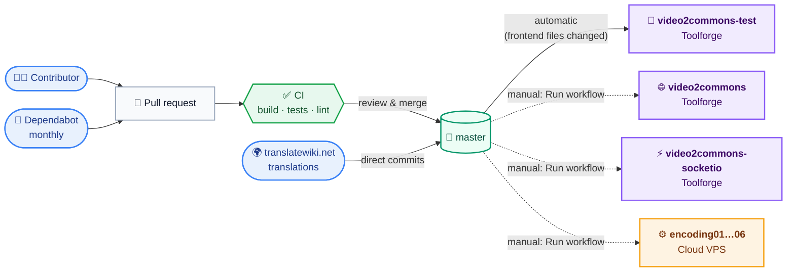
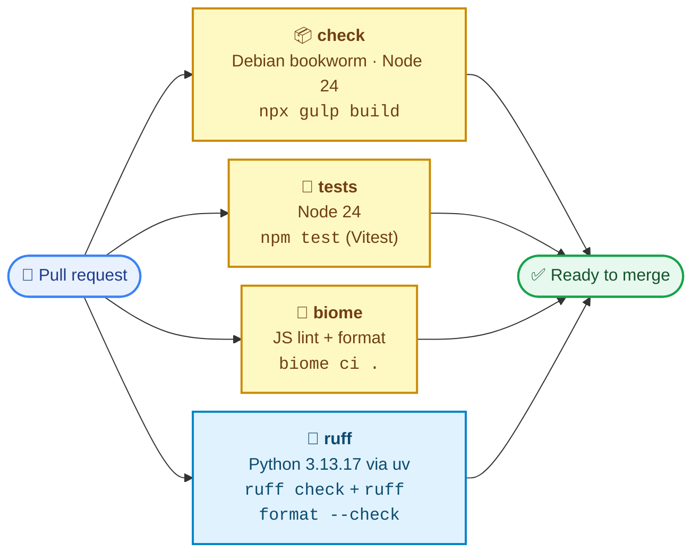
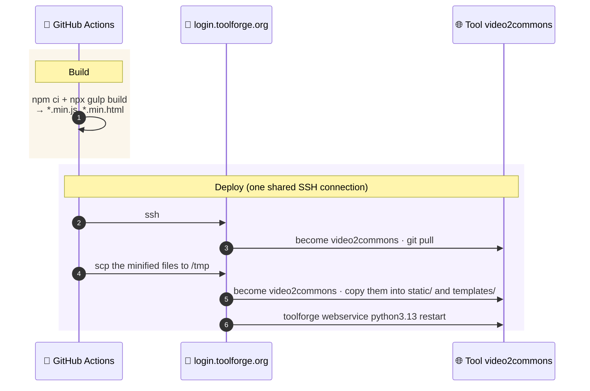
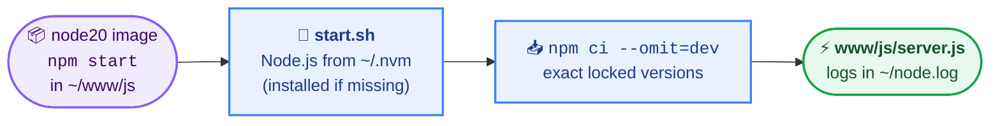
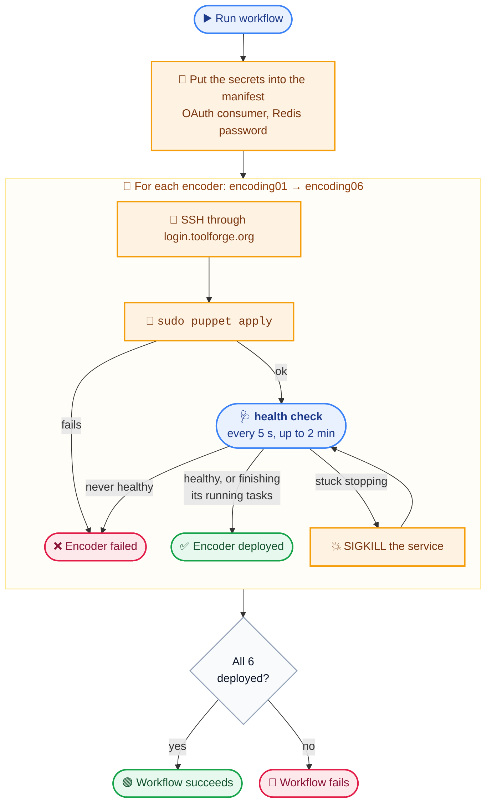
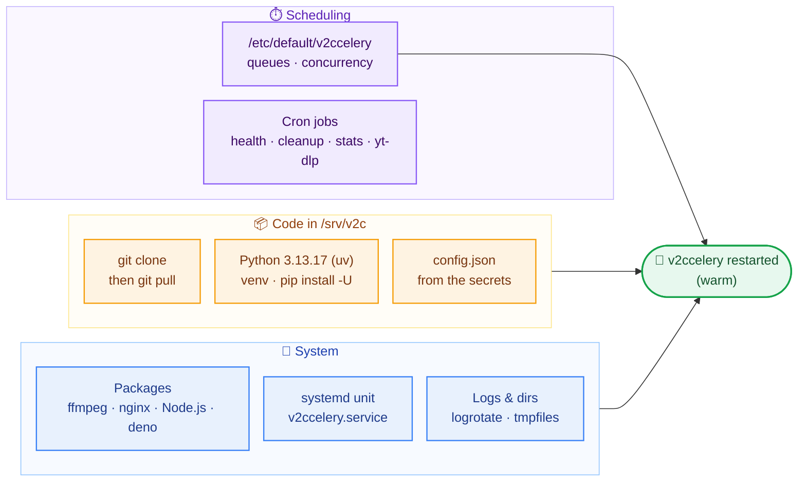
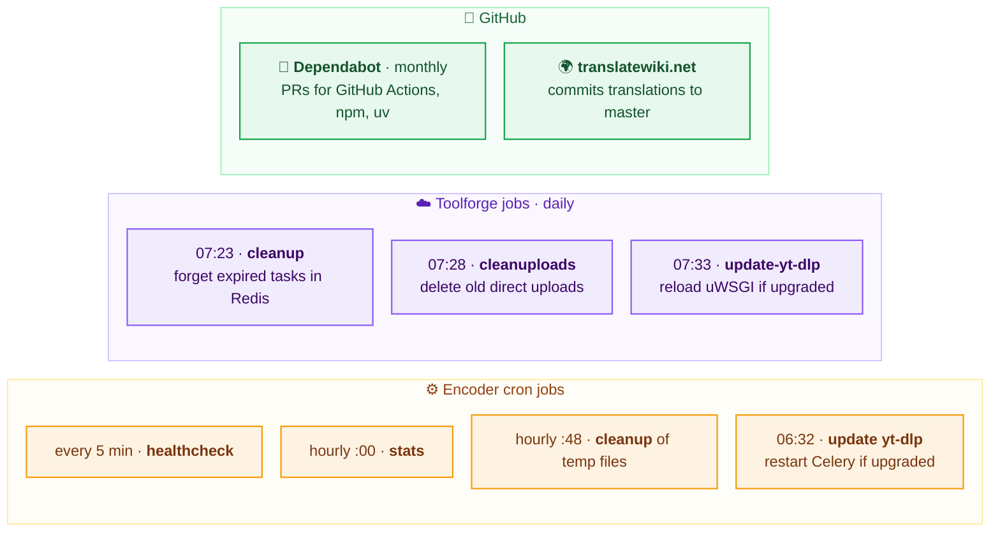

# CI/CD

How code gets checked, deployed and kept up to date. For what each part
does once deployed, see [Architecture](architecture.md).

- [Overview](#overview)
- [Continuous integration](#continuous-integration)
- [Deployments](#deployments)
  - [Web frontend (Toolforge)](#web-frontend-toolforge)
  - [Socket.IO (Toolforge)](#socketio-toolforge)
  - [Encoders (Cloud VPS)](#encoders-cloud-vps)
- [Secrets](#secrets)
- [Automatic maintenance](#automatic-maintenance)
- [Runbook](#runbook)

## Overview



In short:

- every pull request is **checked** automatically;
- merging to `master` **deploys the test instance** automatically, when
  frontend files changed;
- **production** deployments (frontend, Socket.IO, encoders) are triggered
  **by hand** from the Actions tab.

## Continuous integration

[`.github/workflows/ci.yml`](../.github/workflows/ci.yml) runs on every pull
request (opened, updated or reopened). Its four jobs run in parallel and must
all pass:



| Job | Checks | Run it locally |
|---|---|---|
| **check** | The browser code bundles (esbuild) and the templates minify and precompile (Gulp). | `npm ci && npx gulp build` |
| **tests** | The JavaScript tests in [`tests/`](../tests), with a mocked backend (MSW). | `npm test` |
| **biome** | JavaScript linting and formatting ([`biome.json`](../biome.json)). | `npm run lint` (fix: `npm run format`) |
| **ruff** | Python linting and formatting ([`pyproject.toml`](../pyproject.toml)). | `uv run ruff check . && uv run ruff format --check .` |

> [!NOTE]
> CI does **not** cover the Python code's behaviour (there are no Python
> tests), the Puppet manifest or the shell scripts. Changes to the workers, to
> Puppet or to the deployment scripts need a careful review and a close watch
> after deployment.

## Deployments

| Target | Workflow | Trigger | Restarts |
|---|---|---|---|
| 🧪 Test frontend | [Deploy Test Frontend](../.github/workflows/deploy-toolforge-video2commons-test.yml) | push to `master` touching the frontend¹, or manual | uWSGI webservice |
| 🌐 Frontend | [Deploy Frontend](../.github/workflows/deploy-toolforge-video2commons.yml) | manual | uWSGI webservice |
| ⚡ Socket.IO | [Deploy Socket.IO](../.github/workflows/deploy-toolforge-video2commons-socketio.yml) | manual | Node.js webservice |
| ⚙️ Encoders | [Deploy Encoders](../.github/workflows/deploy-cloudvps-encoders.yml) | manual | Celery, warm, on every run |

¹ `video2commons/frontend/`, `video2commons/shared/`, `config.py`,
`exceptions.py`, the Gulp, npm and uv files, or the deployment script itself.

All of them run in the **`WMCS`** GitHub environment, which holds the
[secrets](#secrets), and reach the servers over SSH through the Toolforge
bastion (`login.toolforge.org`).

> [!IMPORTANT]
> Deployments run `git pull` **on the server**: they deploy the current
> `master` from GitHub, not the commit the workflow was started from. Only the
> minified frontend files are built by the workflow itself. To deploy a
> change, merge it first.

### Web frontend (Toolforge)

The frontend lives in `/data/project/video2commons` (or `video2commons-test`),
a git checkout run by Toolforge's `python3.13` webservice (uWSGI), with its
venv in `~/www/python/venv`.
[`utils/deploy-toolforge-frontend.sh`](../utils/deploy-toolforge-frontend.sh):



The minified files are not in git (see [`.gitignore`](../.gitignore)): they
only exist on the server, copied there by each deployment. Python
dependencies are **not** reinstalled by the deployment; yt-dlp is kept up to
date by a [scheduled job](#automatic-maintenance).

### Socket.IO (Toolforge)

[`utils/deploy-toolforge-socketio.sh`](../utils/deploy-toolforge-socketio.sh)
does a `git pull` in `/data/project/video2commons-socketio`, then restarts the
`node20` Kubernetes webservice.

Toolforge's newest Node.js image (`node20`) is too old, so the server doesn't
run on it: following [Toolforge's advice](https://wikitech.wikimedia.org/wiki/Help:Toolforge/Node.js#Using_other_versions_of_node),
it runs on a recent Node.js installed with [nvm](https://github.com/nvm-sh/nvm)
in the tool's home. On each start of the webservice:



The Node.js version is set by `NODE_VERSION` in
[`video2commons-socketio/start.sh`](../video2commons-socketio/start.sh): to
upgrade, change it and deploy, the new version is installed on the next
start. nvm itself must be installed once in the tool's home (see the
[runbook](#socketio-and-nodejs)).

### Encoders (Cloud VPS)

The six encoders are configured by a single **Puppet manifest**,
[`puppet/backend.pp`](../puppet/backend.pp), applied without a Puppet server
(`puppet apply`). [`utils/deploy-cloudvps-encoders.sh`](../utils/deploy-cloudvps-encoders.sh)
deploys the encoders **one after the other**:



Why the health check: Puppet only **asks** systemd to restart the service
(`--no-block`), without waiting. A "successful" `puppet apply` therefore says
nothing about whether Celery actually came back; the check does.

What `puppet apply` does on each encoder:



Things to know:

- **Every run restarts Celery**, even when nothing changed: `git pull` and
  `pip install` run each time and trigger the restart.
- **The restart is warm.** Celery finishes its running tasks before
  restarting, so an encoder busy with a large file may run the old code for
  hours after a "successful" deployment.
- **Dependencies move.** `pip install -U` upgrades the Python dependencies of
  [`requirements.txt`](../video2commons/backend/requirements.txt) on every
  run, and they are not pinned: Pywikibot even comes from its `master`
  branch. A deployment can therefore change more than the merged commits.
- **Python is not Debian's.** Debian bookworm only ships Python 3.11, so
  Puppet installs the version set by `$python_version` with
  [uv](https://docs.astral.sh/uv/) in `/opt/python`, and creates a venv per
  version (`/srv/v2c/venv-<version>`). After a version change, the workers
  still finishing their tasks keep the previous venv until they restart; it
  can then be deleted by hand.
- **Heavy encoders** (`encoding05`, `encoding06`) get a different
  configuration from the same manifest: one task at a time, `heavy` and
  `celery` queues. The others run two tasks at a time on the `celery` queue.

## Secrets

Stored in the **`WMCS`** environment of the GitHub repository (Settings →
Environments):

| Secret | Used by | Purpose |
|---|---|---|
| `SSH_PRIVATE_KEY` | all deployments | SSH key of the deployment account |
| `V2C_USERNAME` | all deployments | Toolforge/Cloud VPS shell account used to connect |
| `V2C_CONSUMER_KEY`, `V2C_CONSUMER_SECRET` | encoders | OAuth consumer, written into the encoders' `config.json` |
| `V2C_REDIS_PW` | encoders | Redis password, same |

The Toolforge tools keep their own `config.json`, edited by hand on the
server: deployments don't touch it.

## Automatic maintenance

Besides deployments, several things update or clean the system on their own:



- **yt-dlp** is updated every day on both sides, because video sites change
  often and an old yt-dlp quickly stops working. The service is reloaded only
  when the version actually changed. On the encoders the restart is warm, as
  for deployments.
- **Toolforge jobs** are defined in [`jobs.yaml`](../jobs.yaml) (load them
  with `toolforge jobs load jobs.yaml`). `cleanuploads.sh` is not in the
  repository: it only exists in the tool's home directory.
- **Encoder cron jobs** are defined in the Puppet manifest; times are in UTC.
  The [health check](architecture.md#keeping-the-encoders-healthy) only
  restarts a running worker after ~24 h without an answer.
- **Translations** arrive as direct commits on `master`. They reach users at
  the next frontend deployment.

## Runbook

### Deploy

1. Merge the pull request into `master`.
2. If the frontend changed, check the test instance, deployed automatically:
   <https://video2commons-test.toolforge.org>.
3. In **Actions**, open the workflow of the part to deploy, then
   **Run workflow** on `master`.
4. Check the result:

| Part | Check |
|---|---|
| Frontend | <https://video2commons.toolforge.org> loads, you can log in and start a task. |
| Socket.IO | The task list updates without reloading the page. |
| Encoders | The workflow is green; tasks leave the "pending" state; the [Grafana board](https://grafana.wmcloud.org/d/0g9N-7pVz/cloud-vps-project-board?var-project=video) shows activity on every encoder. |

### Roll back

There is no dedicated rollback: deployments always take `master`.
**Revert** the faulty commit on `master`, then run the deployment again.

### Socket.IO and Node.js

As the tool (`become video2commons-socketio`). Install nvm once, from its
latest release:

```bash
git clone https://github.com/nvm-sh/nvm.git ~/.nvm
cd ~/.nvm && git checkout "$(git describe --abbrev=0 --tags --match 'v[0-9]*' "$(git rev-list --tags --max-count=1)")"
```

Install the Node.js version of `start.sh` ahead of time, so the next start
doesn't have to download it:

```bash
. ~/.nvm/nvm.sh && nvm install 26.12.1
```

Switching the webservice to another image (here from `node18` to `node20`)
needs a stop and a start, a restart keeps the old image:

```bash
toolforge webservice stop
toolforge webservice --backend=kubernetes node20 start
```

To check the result: `kubectl get pods`, `kubectl logs <pod>` (start script
and `npm ci`) and `tail ~/node.log` (server).

### Python on Toolforge

The frontend runs on Toolforge's Python image: to change its Python version,
the venv must be rebuilt in the new image, for `video2commons` and for
`video2commons-test`. As the tool (`become video2commons`):

```bash
toolforge webservice stop
mv ~/www/python/venv ~/www/python/venv-old
toolforge webservice python3.13 shell
```

In that shell:

```bash
python3 -m venv ~/www/python/venv
~/www/python/venv/bin/pip install -U pip
~/www/python/venv/bin/pip install -r ~/video2commons/frontend/requirements.txt -r ~/video2commons/backend/requirements.txt
exit
```

Then start the webservice with the new image, and reload the jobs, whose
image must match the venv:

```bash
toolforge webservice python3.13 start
toolforge jobs load ~/jobs.yaml
```

Once everything works, `~/www/python/venv-old` can be deleted.

### On an encoder

```bash
systemctl status v2ccelery --no-pager       # state of the service
sudo bash /srv/v2c/utils/healthcheck.sh --check
journalctl -u v2ccelery -n 100 --no-pager   # service start/stop
journalctl -t v2c-healthcheck -n 50         # what the health check did
tail -f /var/log/v2ccelery/celery1-*.log    # task logs
```

| Symptom | Likely cause | What to do |
|---|---|---|
| Unit `deactivating` for a long time, no worker process | Stop blocked by leftover processes | `sudo systemctl kill --kill-whom=all -s SIGKILL v2ccelery`; systemd restarts it. The health check does it after 15 min. |
| Unit `deactivating`, worker still running | Warm restart waiting for running tasks | Nothing: it restarts once the tasks are done. |
| Tasks fail with `WorkerLostError` | Worker killed in the middle of a task (memory, restart) | Look for `oom` in `journalctl -k` and for restarts in the health check log. |
| Workflow red on one encoder | `puppet apply` failed, or the service didn't come back | Run `sudo puppet apply` by hand to see the error, or check the service. |
