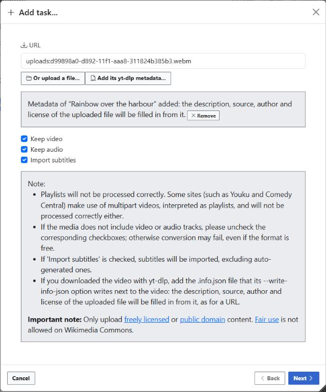
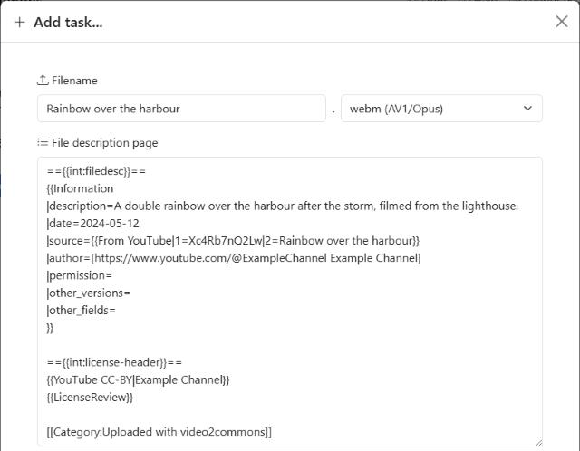

# Uploading a video downloaded with yt-dlp

video2commons usually downloads the video itself from its URL. When it can't,
for example when YouTube blocks the server with "Sign in to confirm you're not
a bot", you can download the video on your computer with
[yt-dlp](https://github.com/yt-dlp/yt-dlp) and upload the file instead.

An uploaded file comes with an empty description, without its source, author
or license. If you add the metadata that yt-dlp wrote for the video, the
description is filled in exactly as for its URL.

## How to

1. Download the video and its metadata with yt-dlp:

   ```bash
   yt-dlp --write-info-json "https://www.youtube.com/watch?v=..."
   ```

   Next to the video, yt-dlp writes a file with the same name ending in
   `.info.json`, e.g. `Rainbow over the harbour [Xc4Rb7nQ2Lw].info.json`.

2. In video2commons, click **Add task...**, then **Or upload a file...** and
   choose the video.
3. Click **Add its yt-dlp metadata...** and choose the `.info.json` file. You
   can add it before, during or after the upload of the video.

   

4. Click **Next**: the filename and the description come from the metadata,
   with the [`{{From YouTube}}`](https://commons.wikimedia.org/wiki/Template:From_YouTube)
   source, the author and the license.

   

5. Check the description and the license, and continue as usual.

To go back to an empty description, click **Remove** next to the metadata.

## What video2commons checks

The metadata comes from your computer, like the file itself. video2commons
doesn't check it against the video site, so it doesn't prove the license:

- The license is filled in from the metadata, like for a URL. If the video
  isn't under a free license, the description gets the "no license" template,
  which you must replace.
- As for any upload with `{{LicenseReview}}`, a reviewer on Commons checks the
  license at the source afterwards.
- For a YouTube video, video2commons checks that no file of Commons has its
  YouTube ID yet, like for its URL.

Only the fields that the description needs are sent to the server, which
leaves out a field that has the wrong type or format, so that the description
stays well-formed. A file that isn't the metadata of a single video (e.g. the
metadata of a playlist) is refused.

Any site supported by yt-dlp works, with the description and license that
video2commons makes for its URLs (e.g. `{{From Vimeo}}` and Vimeo's
licenses).
